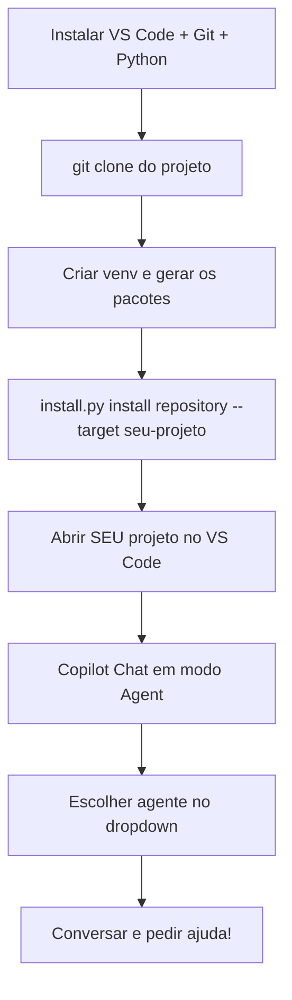

# Tutorial: Como instalar e usar o Awesome Copilot Agents no Windows 🧑‍💻🤖

Oi! Esse tutorial vai te ensinar, passo a passo, como colocar uma **equipe de 33 robôs ajudantes** (agentes) e **21 "manuais de instrução"** (skills) dentro do GitHub Copilot, usando um computador **Windows** com **VS Code**.

Vou explicar como se você tivesse 10 anos — sem pressa, sem palavras difíceis. 🙂

> **O que é isso, afinal?**
> Imagina que o Copilot é um ajudante que sabe programar. Só que, sozinho, ele é "genérico" — sabe um pouco de tudo. Esse projeto dá pra ele uma **equipe inteira de especialistas**: um que entende de Django, outro de React, outro que só revisa código, etc. Cada um tem sua função, como num time de futebol.

---

## 🧰 Parte 1 — O que você precisa ter antes de começar

Pense nisso como a "lista de material escolar". Você precisa ter:

1. **Um computador com Windows** ✅ (você já tem)
2. **O VS Code instalado** — é o programinha onde a gente escreve código.
   - Se não tiver, baixe aqui: https://code.visualstudio.com/
3. **A extensão do GitHub Copilot Chat** instalada no VS Code (e uma assinatura do Copilot ativa, com "agentes customizados" e "Agent Skills" liberados).
4. **O Git para Windows** — ajuda a "baixar" o projeto do GitHub.
   - Baixe aqui: https://git-scm.com/download/win
5. **O Python 3.11 ou mais novo** — é o que faz o instalador funcionar.
   - Baixe aqui: https://www.python.org/downloads/
   - ⚠️ Importante: na hora de instalar o Python, marque a caixinha **"Add python.exe to PATH"**. Isso é tipo deixar uma "placa de sinalização" pro Windows achar o Python depois.

> 💡 Dica: depois de instalar cada um desses programas, é bom **fechar e abrir o terminal de novo** (ou reiniciar o computador), pra tudo funcionar direitinho.

---

## 📥 Parte 2 — Baixando o projeto

Vamos abrir o **Terminal** do Windows. Pode ser o "PowerShell" (já vem no Windows).

1. Clique no botão **Iniciar** do Windows.
2. Digite `PowerShell` e aperte Enter.
3. Uma telinha preta/azul vai abrir — é o terminal. É aqui que digitamos comandos.

Agora, dentro do terminal, escreva este comando pra escolher uma pasta onde vamos trabalhar (por exemplo, a pasta de Documentos):

```powershell
cd $env:USERPROFILE\Documents
```

Aperte Enter. Agora vamos "baixar" (clonar) o projeto:

```powershell
git clone https://github.com/<organizacao>/awesome-copilot-agents.git
cd awesome-copilot-agents
```

> Troque `<organizacao>` pelo endereço real do repositório que vocês criaram no GitHub.

Pronto! Agora você tem uma pastinha chamada `awesome-copilot-agents` no seu computador, com todos os agentes e skills dentro dela.

---

## 🛠️ Parte 3 — Preparando o "robozinho instalador"

Esse projeto tem um programinha em Python que copia os agentes para dentro do seu projeto de verdade. Vamos preparar ele.

Ainda dentro da pasta `awesome-copilot-agents` no terminal, digite:

```powershell
python -m venv .venv
.venv\Scripts\pip install -e ".[dev]"
.venv\Scripts\python scripts\generate.py --release
```

O que cada linha faz (em miúdos):

| Comando | O que faz (explicação simples) |
|---|---|
| `python -m venv .venv` | Cria uma "caixinha de ferramentas" separada, só para esse projeto, pra não bagunçar nada do seu Python. |
| `.venv\Scripts\pip install -e ".[dev]"` | Instala as peças que o robô instalador precisa pra funcionar. |
| `.venv\Scripts\python scripts\generate.py --release` | Monta (gera) todos os arquivos dos 33 agentes e das 21 skills, prontinhos para usar. |

Se aparecer bastante texto rolando na tela, tudo bem — é normal, é o computador "trabalhando".

---

## 📂 Parte 4 — Colocando os agentes dentro do SEU projeto

Agora vem a parte mais importante: colocar essa equipe de robôs dentro do projeto onde você vai programar de verdade (seu app, seu site, etc).

Digamos que seu projeto fica em `C:\MeusProjetos\meu-app`. No terminal (ainda dentro da pasta `awesome-copilot-agents`), digite:

```powershell
.venv\Scripts\python scripts\install.py install repository --target C:\MeusProjetos\meu-app
```

> Troque `C:\MeusProjetos\meu-app` pelo caminho real do SEU projeto.

Isso vai copiar, dentro do seu projeto:

- `.github\agents\` → os 33 agentes especialistas
- `.github\skills\` → as 21 skills (os "manuais de instrução")
- `.github\copilot-instructions.md` → as instruções gerais da equipe

É como se você tivesse colado um "time de super-heróis" dentro da mochila do seu projeto. 🦸

### Como saber se deu certo?

No terminal, digite (ainda em `C:\MeusProjetos\meu-app` — use `cd` para entrar lá):

```powershell
cd C:\MeusProjetos\meu-app
(Get-ChildItem .github\agents\*.agent.md).Count
(Get-ChildItem .github\skills -Directory -Filter "aca-*").Count
```

O primeiro comando deve mostrar o número **33**.
O segundo deve mostrar o número **21**.

Se os números baterem, parabéns, deu tudo certo! 🎉

### Quer tirar tudo depois? (desinstalar)

Se um dia você quiser remover a equipe de agentes do seu projeto, é só rodar (lá na pasta `awesome-copilot-agents`):

```powershell
.venv\Scripts\python scripts\install.py uninstall repository --target C:\MeusProjetos\meu-app
```

Ele só remove os arquivos que ele mesmo colocou — nunca mexe em coisas suas.

---

## 💻 Parte 5 — Abrindo tudo no VS Code

1. Abra o **VS Code**.
2. Clique em **File → Open Folder...** (Arquivo → Abrir Pasta...).
3. Escolha a pasta do **seu projeto** (`C:\MeusProjetos\meu-app`), não a pasta `awesome-copilot-agents`.
4. Clique em **Selecionar Pasta**.

Pronto, agora o VS Code está "olhando" para o seu projeto, que já tem os agentes dentro de `.github\`.

---

## 🤖 Parte 6 — Conversando com os agentes

Agora é hora de chamar os robôs ajudantes!

1. No VS Code, clique no ícone do **Copilot Chat** (geralmente fica na barra lateral, do lado direito ou esquerdo).
2. Lá em cima/embaixo da caixa de chat, procure um seletor de **modo** e escolha **Agent** (modo agente). É esse modo que deixa o Copilot usar ferramentas e os agentes especiais.
3. Procure um **menu dropdown de agentes** (geralmente perto da caixa onde você digita a mensagem). Nele você escolhe **qual especialista** quer chamar — por exemplo:
   - `team-configurator` → organiza a equipe para o seu projeto
   - `tech-lead-orchestrator` → planeja tarefas grandes e chama os especialistas certos
   - `code-reviewer` → revisa seu código
   - `django-api-developer`, `react-component-architect`, etc → especialistas de cada tecnologia
4. Se não aparecer a lista de agentes, digite `/agents` no chat, ou abra a **Paleta de Comandos** (`Ctrl+Shift+P`) e procure por **"Chat: Configure Custom Agents"**.
5. Se mesmo assim não aparecer nada novo, **feche e abra o VS Code de novo** (ou comece uma nova conversa no chat) — às vezes ele precisa "perceber" os arquivos novos.

### Primeira coisa a fazer: configurar a equipe

Escolha o agente `team-configurator` no menu e escreva algo como:

```text
Detecte a stack deste repositório e mostre uma prévia de configuração da
equipe de IA para .github/copilot-instructions.md. Não altere instruções
até eu aprovar a prévia.
```

Esse robô vai **olhar seu projeto**, descobrir quais tecnologias você usa (tipo React, Django, etc.) e sugerir quais especialistas são os melhores pra te ajudar. Ele só muda as coisas depois que você disser "sim, pode".

### Para tarefas grandes, chame o "líder do time"

Escolha `tech-lead-orchestrator` e peça, por exemplo:

```text
Analise este pedido e devolva um Route Plan com os agentes exatos que
devem trabalhar, dependências entre eles e onde revisar: construir um
sistema de login de usuários.
```

Ele vai montar um **plano**, dizendo quais especialistas (no máximo 2 trabalhando ao mesmo tempo) devem entrar em ação, em que ordem, e quando chamar o `code-reviewer` pra conferir o código antes de terminar.

---

## 🧠 Resumo bem resumido (pra colar na geladeira)



1. Instale VS Code, Git e Python.
2. Baixe (clone) o projeto `awesome-copilot-agents`.
3. Crie o ambiente (`venv`) e gere os pacotes.
4. Instale os agentes dentro do SEU projeto com `scripts\install.py`.
5. Abra o SEU projeto (não o `awesome-copilot-agents`) no VS Code.
6. Ligue o modo **Agent** no Copilot Chat.
7. Escolha um agente no menu e converse com ele!

---

## 🆘 Deu algum problema?

- **Não aparece o menu de agentes?** Reinicie o VS Code ou comece uma nova conversa no chat.
- **Deu erro de "python não é reconhecido"?** Reinstale o Python marcando a caixinha "Add python.exe to PATH" e reinicie o terminal.
- **Contagem de arquivos não bateu (33 agentes / 21 skills)?** Rode de novo o passo da Parte 4; confira se o caminho (`--target`) está certo.
- Para mais ajuda: veja [docs/pt-BR/troubleshooting.md](docs/pt-BR/troubleshooting.md) e [docs/pt-BR/install-vscode.md](docs/pt-BR/install-vscode.md).

Divirta-se programando com sua nova equipe de robôs! 🚀🤖
